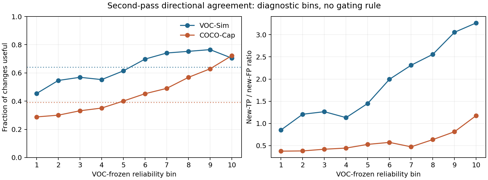

# Pre-SG16 and Pre-SG17 prerequisite diagnostics

## Scope and validity

All **490 VOC-Sim** and **707 COCO-Cap** annotated images were regenerated with
the frozen training-free class-word CA and module-15 SA settings. All 40 GPU
class shards completed, and the corrected CPU merge completed. The result
contains **15,680 VOC** and **22,624 COCO** nonempty SPEC32 regions: exactly
32 per image. Image IDs, region coverage, changed-pixel event accounting and
merged histogram totals were checked. Each image was processed once; only
reduced per-image records and histograms were retained.

The frozen P1, SG11 and SG12 thresholds are those selected on VOC in SG15.
One-pass and two-pass masks use the preregistered threshold **0.45**, after
independent min-max normalization and bilinear resize. GT supplies only
diagnostic labels, masks and metrics. No classifier, GT-based feature,
threshold search, new prediction rule or SG16/SG17 pipeline was created.

For ROC-AUC, 0.5 means random ranking; average precision (AP) should be read
against each subset's positive prevalence. Region AUC/AP is exact. Changed-
pixel AUC/AP uses every eligible pixel in **1,024 fixed score bins**; it is a
bounded-memory approximation with half-credit ROC ties. The full result JSON
contains both raw and inverse score directions, all features, every class,
restricted subsets and area bins. Tables below use the raw score direction.

## Pre-SG16: Can observation evidence distinguish target regions?

The GT-majority diagnostic labels a region foreground when at least half of
its annotation pixels are target. The important subset is **ambiguous P1**:
its frozen P1 foreground occupancy lies in `[0.2, 0.8]`.

| Region feature | VOC all ROC / AP | VOC ambiguous ROC / AP | COCO all ROC / AP | COCO ambiguous ROC / AP |
|---|---:|---:|---:|---:|
| P1 foreground occupancy | .951 / .940 | .657 / .504 | .907 / .753 | .659 / .357 |
| Mean occupancy of P1, SG11, SG12 | **.957 / .950** | .652 / .515 | .914 / .776 | .656 / .343 |
| Strongest of three occupancies | .954 / .941 | **.686 / .564** | .905 / .748 | .647 / .317 |
| Direct CA mean | .936 / .934 | .501 / .364 | .925 / .854 | .595 / .309 |
| Ordinary one-pass region mean | .949 / .949 | .578 / .437 | .929 / .867 | .620 / .383 |
| All-observation trimmed mean, 20% | .952 / .952 | .586 / .444 | .931 / .871 | .627 / .391 |
| SG12-top50 observation median | .952 / .953 | .597 / .452 | .931 / .871 | .629 / .389 |
| SG12 occupancy | .952 / .943 | .632 / .499 | .911 / .764 | **.673 / .357** |

The easy majority of regions explains the high all-region AUC. On the **1,603
VOC / 2,415 COCO ambiguous regions**, observation values rank *worse* than
the simple prior occupancies. Class-balanced ambiguous ROC-AUC agrees:
P1 occupancy **.715 / .717** (VOC/COCO), all-observation trimmed mean
**.691 / .709**, and SG12-top50 observation mean **.695 / .705**.
Selecting the 124 SG12 observations does not recover the missing signal.

On the P1-majority-*wrong* subset (1,610 VOC / 3,690 COCO regions), the
fraction of observations whose propagated region value exceeds direct CA
(`r_up`) gives ROC-AUC **.785 / .714**. This is exploratory only. Membership
in this subset itself uses GT: P1 occupancy is necessarily anti-correlated
with the oracle label (raw AUC 0, inverse AUC 1) by construction. It would be
incorrect to cite the `r_up` result as evidence that a deployable rule can
identify its own errors. Among prior-disagreement regions (533 VOC / 994
COCO), the strongest raw AUC is only **.681** for occupancy disagreement on
VOC and **.636** for SG12 occupancy on COCO; `r_up` is **.602 / .490**.

### How much does the fixed partition help?

| Mean-image IoU | VOC | COCO |
|---|---:|---:|
| Frozen P1 mask | .8032 | .6511 |
| GT-majority SPEC32 mask | .8864 | .8044 |
| Mean within-image oracle-minus-P1 difference | +.0832 | +.1533 |
| Images with positive difference | 71.6% | 72.6% |

This shows **partition headroom**, especially on COCO, but it is not evidence
that the tested features can recover the region labels. The GT-majority mask
maximizes within-region pixel accuracy; it is **not a mathematical upper bound
on IoU** and can score below the original pixelwise P1 mask.

The gain does not concentrate cleanly in large or compact objects. Spearman
correlation with target area fraction is **+.011 VOC / −.001 COCO**; with
compactness **−.053 / +.003**. The strong negative correlation with P1 IoU
(**−.787 / −.772**) mostly reflects that a weaker prior has more room to
improve, so it should not be treated as a causal morphology finding. Area-bin
and all 20 per-class AUCs are in `results.json`; they do not change the
ambiguous-region conclusion. COCO `person` is difficult even in all-region
ranking: P1 occupancy AUC **.637**, ordinary observation mean **.581**.

**Pre-SG16 decision:** the preregistered promising pattern did **not** appear.
The best observation statistics remain well below ~.80 ROC-AUC on ambiguous
regions and do not outperform prior occupancy there. A new full SG16 region
recovery run is not supported by this evidence.

## Pre-SG17: Can reliability predict whether a second SA pass helps?

For each changed pixel, a useful change is FN→TP or FP→TN; a harmful change
is TP→FN or TN→FP. `second_q_direction` is the fraction of all 248
observations whose individual second-minus-first value supports the *actual
binary change direction*. `top50_q_direction` uses the frozen SG12 top 124.
`support_reliability` averages the SG12 cosine reliability of observations
supporting that direction. All features are computed without GT.

| Diagnostic event | VOC count / useful fraction | COCO count / useful fraction |
|---|---:|---:|
| All changed pixels | 2,679,972 / **64.0%** | 4,678,663 / **39.0%** |
| Additions: new TP vs new FP | 1,798,753 / **60.8% TP** | 3,904,159 / **31.0% TP** |
| Removals: FP→TN vs TP→FN | 881,219 / **70.6% useful** | 774,504 / **79.4% useful** |
| New false positives >16 px from GT | 430,361 | 2,237,614 |
| New false positives >64 px from GT | 214,220 | 1,555,692 |
| New false positives in a GT-disjoint component | 46,890 | 362,395 |

The ordinary two-pass mask changes mean-image IoU **.7907→.8032 on VOC**
(+ .0125) and **.6489→.6511 on COCO** (+ .0022). It improves **69.0%** of
VOC images and **52.5%** of COCO images, despite many harmful COCO additions.

| Feature, raw direction | VOC useful/harmful ROC / AP | COCO useful/harmful ROC / AP | COCO new TP/FP ROC | COCO new TP/distant FP >16 ROC |
|---|---:|---:|---:|---:|
| First-pass max directional consensus | .551 / .670 | .530 / .413 | .517 | .497 |
| Mean reliability of supporting observations | .520 / .668 | .538 / .456 | **.603** | **.589** |
| **Second-pass directional agreement** | **.617 / .709** | .634 / .543 | .556 | .550 |
| Second-pass signed 10% trimmed mean | .590 / .690 | **.635 / .549** | .547 | .543 |
| Top50 second-pass directional agreement | .565 / .678 | .608 / .505 | .538 | .532 |

The strongest VOC useful/harmful signal, `second_q_direction`, transfers
directionally to COCO but remains below the requested **.65** ROC-AUC bar on
both datasets. The top50 restriction weakens it. Its AUC for discriminating
new COCO true positives from distant false positives is only **.550**.
`support_reliability` is weak overall, although it distinguishes new TP from
false positives in a separate GT-disjoint component at **.726 VOC / .742
COCO** ROC-AUC. That is a *specific leakage diagnostic*, not evidence for a
general second-pass gate.

### Frozen VOC reliability bins transferred to COCO

The following bins rank `second_q_direction`; VOC bin edges are applied
unchanged to COCO, so COCO bins have unequal pixel counts.

| Bin | VOC useful fraction | VOC new-TP/new-FP ratio | COCO useful fraction | COCO new-TP/new-FP ratio | COCO distant-FP fraction of additions |
|---:|---:|---:|---:|---:|---:|
| 1, lowest | .454 | .853 | .288 | .376 | .583 |
| 5 | .614 | 1.452 | .401 | .529 | .570 |
| 8 | .753 | 2.558 | .569 | .637 | .524 |
| 9 | **.765** | 3.054 | .629 | .814 | .462 |
| 10, highest | .705 | **3.266** | **.722** | **1.178** | **.355** |

There is a useful high-score tail, particularly on COCO: the top bin has
72.2% useful changes versus 39.0% overall, and its distant-FP share among
additions falls to 35.5% versus 58.3% in the lowest bin. The VOC usefulness
curve is **not monotonic**: it peaks in bin 9 and falls in bin 10. The COCO
curve rises across these transferred bins. Image-level median directional
agreement predicts whether two-pass improves IoU with ROC-AUC **.631 VOC /
.674 COCO**; this is modest and does not meet the pixel-level criterion.

**Pre-SG17 decision:** no broad adaptive-depth SG17 run is justified under
the preregistered `useful/harmful AUC ≥ .65` condition. The transferred
high-reliability tail and the separate-component result are narrower leads
for discussion, but designing a new mask gate from these diagnostics would be
a separate experiment with VOC-only selection and frozen COCO evaluation.

## Files for independent inspection

- `results.json`: every feature's raw/inverse ROC-AUC and AP, restricted
  subsets, class-balanced and per-class AUC, area bins, oracle correlations,
  all changed-pixel endpoints, image-level correlations and reliability bins.
- `voc_regions.csv` / `coco_regions.csv`: one record per SPEC32 region with
  GT diagnostic label and all training-free features.
- `voc_region_images.csv` / `coco_region_images.csv`: P1/oracle image IoUs and
  geometry measurements.
- `voc_second_pass_images.csv` / `coco_second_pass_images.csv`: event counts,
  one/two-pass image IoU and changed-pixel reliability summaries.

The downloadable ZIP contains these files and this analysis. The per-image
NPZ checkpoints are excluded because the CSV/JSON exports contain the needed
reduced data. The smoke outputs and earlier SG15 visual comparison are not
part of either full-dataset diagnostic.
