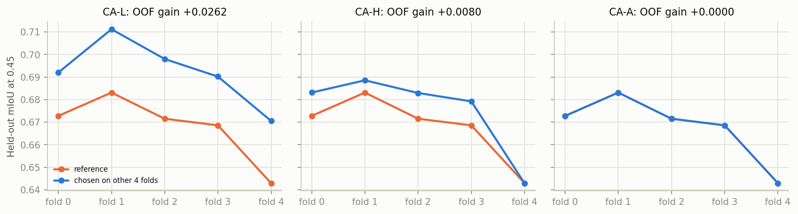
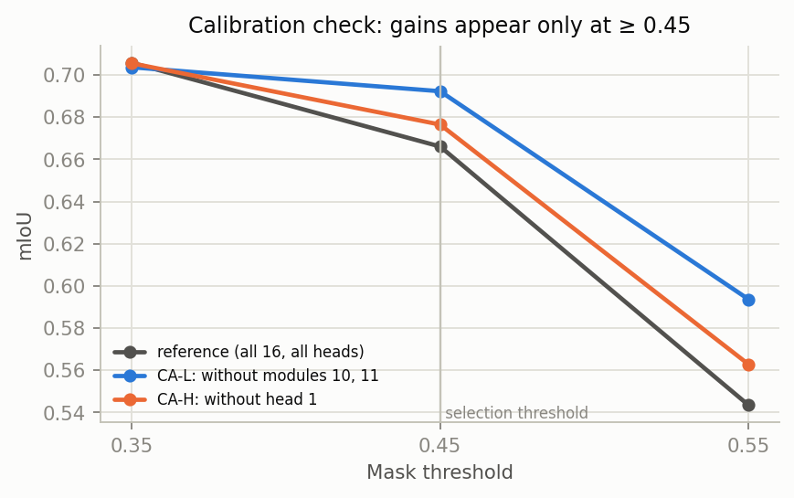

# Evidence: every experiment and how each setting was reached

Generated by `scripts/narmyn/attention/build_evidence.py` from the committed result files; nothing is re-run. mIoU is the 20-class macro mean of pooled foreground IoU unless stated.

**How to read it.** Experiments are in two tiers.

- **Tier B (B1–B17), exploratory.** Settings were chosen on the same images they are reported on (the 99 dev images are part of the 490). These numbers show how the method was found, not how well it generalizes.
- **Tier A (A1, A2), controlled.** Protocol v1.2: one axis at a time from a fixed reference, settings chosen on four folds and scored on the fifth, frozen only with 4 of 5 fold votes and an out-of-fold gain. Only A1 (CA layers, heads, attribution) is complete; nothing is frozen until the combined CA confirmation.

Full data: `all_configurations.csv.gz` (one row per configuration, all experiments), `controlled_ca_package_b.csv` (the 426 controlled configurations with per-fold held-out mIoU, thresholds 0.35/0.45/0.55 and AP), `ledger.csv`, `tables/*.md|tex`, `figures/*.png|pdf`.

## 1. Every experiment

| ID | Experiment | Dataset | Status | Configurations | Best mIoU | Decision / role |
|---|---|---|---|---:|---:|---|
| B1 | CA time windows and resolutions | VOC-Sim dev subset (99 images, 4 classes; inside the 490) | exploratory, in-sample | 11 | 0.7095 | first look at time and resolution |
| B2 | Single and leave-out CA layers | VOC-Sim dev subset (99 images, 4 classes; inside the 490) | exploratory, in-sample | 24 | 0.7232 | layer screening |
| B3 | Joint time x resolution | VOC-Sim dev subset (99 images, 4 classes; inside the 490) | exploratory, in-sample | 21 | 0.7095 | interaction check |
| B4 | Exhaustive CA layer subsets | VOC-Sim dev subset (99 images, 4 classes; inside the 490) | exploratory, in-sample | 17 | 0.7409 | chose BEST_12 = layers {0,2,5,6,7,9,10,11,12,13,14,15} |
| B5 | Threshold x normalization | VOC-Sim dev subset (99 images, 4 classes; inside the 490) | exploratory, in-sample | 153 | 0.7439 | chose percentile 1-99 and threshold 0.45 |
| B6 | Stage-1 suite (heads, time-layer, fusion, cleanup) | VOC-Sim dev subset (99 images, 4 classes; inside the 490) | exploratory, in-sample | 590 | 0.7691 | chose the fixed top-4 CA heads per layer |
| B7 | Self-attention screens and progressive SA | VOC-Sim dev subset (99 images, 4 classes; inside the 490) | exploratory, in-sample | 5320 | 0.8355 | first evidence that SA propagation helps |
| B8 | Full streaming ablations | VOC-Sim (490 images, 20 classes) | exploratory, in-sample (choices from B1-B7 frozen) | 6261 | 0.7777 | SA at U3.2 (64x64), 4 passes: 0.7777 |
| B9 | Focused SA follow-up | VOC-Sim (490 images, 20 classes) | exploratory, in-sample | 1632 | 0.7922 | top-4-head seed, 2 passes, t=0.45: 0.7922 |
| B10 | Joint SA head x time x passes x threshold | VOC-Sim (490 images, 20 classes) | exploratory, in-sample | 4680 | 0.7997 | final method: 4 passes, heads {0,1,2,4,5,6}, calls 15-30, t=0.45, 1% cleanup: 0.7997 |
| B11 | Component ablation of the final method | VOC-Sim (490 images, 20 classes); COCO-Cap (707 images, 20 classes) | exploratory (COCO untuned) | 18 | 0.7999 | SA propagation is the largest component |
| B12 | COCO-Cap generalization of the final method | COCO-Cap (707 images, 20 classes) | untuned transfer | 6 | 0.6080 | 0.5719 -> 0.6080 |
| B13 | Revised system (1 pass, all 16 CA layers) and its ablation | VOC-Sim (490 images, 20 classes); COCO-Cap (707 images, 20 classes) | exploratory; informed by COCO-Cap | 14 | 0.7837 | revised system: VOC 0.7824, COCO 0.6322 |
| B14 | CA call windows with all SA heads | VOC-Sim (490 images, 20 classes); COCO-Cap (707 images, 20 classes) | exploratory | 4 | 0.7811 | no gain over all calls |
| B15 | Clean CA-only screens (pre-sync) | VOC-Sim (490 images, 20 classes) | exploratory, in-sample; audited, superseded by A1 | 1573 | 0.6968 | ratified as correct; re-run with folds as A1 |
| B16 | OVAM released masks | VOC-Sim (490 images, 20 classes) | reference (authors' masks) | 3 | 0.8247 | 0.7036 / 0.8247 / 0.6616 |
| B17 | OVAM optimized token and DenseCRF on the final method | VOC-Sim (490 images, 20 classes); COCO-Cap (707 images, 20 classes) | exploratory; nothing selected | 32 | 0.8553 | token + DenseCRF: VOC 0.8525, COCO 0.6612 |
| A1 | Controlled CA package B: CA-L, CA-H, CA-A | VOC-Sim (490 images, 20 classes) | controlled, 5-fold cross-validated | 65961 | 0.6923 | CA-L drop modules 10-11; CA-H drop head 1; CA-A keep reference (CA-C pending) |
| A2 | Controlled CA package A: CA-T, CA-R | VOC-Sim (490 images, 20 classes) | controlled, 5-fold cross-validated (Codex) | — | — | pending |

## 2. Where each setting came from

| Setting | Value used so far | Chosen in | Images used to choose | Evidence | Controlled status |
|---|---|---|---|---|---|
| CA layers | 12 of 16 (drop 1, 3, 4, 8) | B4 exhaustive search | 99 dev images | ledger B4; Fig. a1_exhaustive | A1 CA-L (CV): keep all but modules 10, 11 instead; awaiting CA-C |
| CA heads | fixed top-4 per layer | B6 stage-1 suite | 99 dev images | ledger B6 | A1 CA-H (CV): drop head 1 in every module; awaiting CA-C |
| CA attribution | OVAM: unconditional query, unpadded softmax, first piece | inherited from OVAM | — | Table a1_ca_a | A1 CA-A (CV): reference (conditional, padded, all pieces) kept; OVAM's cell is −0.0156 CA-only |
| CA calls | all 31 (0–30) | B1/B8 windows; B14 | 99 dev / 490 | ledger B1, B8, B14 | A2 CA-T (Codex), pending |
| CA normalization, threshold | percentile 1–99, ≥ 0.45 | B5 | 99 dev images | ledger B5 | protocol fixes min–max, 0.45 for the CA phase |
| SA module | U3.2 (up_blocks.3.attentions.2 attn1, 64×64) | B8 SA screens | 490 (in-sample) | ledger B8 | SA-L (Claude) after CA freeze |
| SA passes | 4 (revised: 1) | B10; revised from B11/B13 | 490; 1-pass informed by COCO-Cap | Fig. b_joint_passes_time | after SA freeze |
| SA heads | {0,1,2,4,5,6} | B10 | 490 (in-sample) | Fig. b_joint_heads_threshold | SA-H (Claude) after CA freeze |
| SA calls | 15–30 | B10 | 490 (in-sample) | Fig. b_joint_passes_time | SA-T (Codex) after CA freeze |
| Mask threshold | 0.45 | B5, B9, B10 | 99 dev / 490 | Fig. b_joint_heads_threshold | fixed at 0.45; 0.35/0.55 as diagnostics |
| Cleanup | remove components < 1% | B10 | 490 (in-sample) | Table b_component_ablations | deferred phase |
| DenseCRF | not in the final method | B17 (nothing selected) | — | Table b_token_crf | deferred phase |
| Optimized token | not in the final method | B17 (nothing selected; tokens trained by OVAM on separate images) | — | Table b_token_crf | deferred phase |

## 3. Development of the method and its baselines

*Fig. 1. Each step of the method and the baselines. VOC-Sim values are in-sample; COCO-Cap was never used to choose the earlier final method.*

| Dataset | Method | mIoU | Evidence |
|---|---|---:|---|
| VOC-Sim | OVAM CA only (released heatmaps) | 0.6616 | B16 |
| VOC-Sim | OVAM CA only (regenerated) | 0.6540 | B8 |
| VOC-Sim | OVAM, implemented (CA×SA, DenseCRF) | 0.6934 | attention_analysis.md |
| VOC-Sim | OVAM, released masks | 0.7036 | B16 |
| VOC-Sim | + SA propagation at U3.2, 4 passes | 0.7777 | B8 |
| VOC-Sim | + top-4-head CA seed, 2 passes, t=0.45 | 0.7922 | B9 |
| VOC-Sim | + heads {0,1,2,4,5,6}, calls 15–30, 4 passes, 1% cleanup | 0.7997 | B10 |
| VOC-Sim | Revised: 1 pass, all 16 CA layers | 0.7824 | B13 |
| VOC-Sim | OVAM token-optimized, released masks | 0.8247 | B16 |
| VOC-Sim | Earlier final + optimized token + DenseCRF (1 pass) | 0.8525 | B17 |
| COCO-Cap | OVAM, implemented (paper COCO parameters) | 0.5717 | B17 |
| COCO-Cap | Final method, frozen from VOC | 0.6080 | B12 |
| COCO-Cap | Revised: 1 pass, all 16 CA layers | 0.6322 | B13 |
| COCO-Cap | Earlier final + optimized token + DenseCRF (1 pass) | 0.6612 | B17 |
| COCO-Cap | OVAM token-optimized (paper Table 1) | 0.6920 | OVAM paper |

## 4. Controlled CA experiments (tier A1, cross-validated)

Fixed condition (protocol Section 3): CA only; calls 0–30; conditional query; softmax over 77 padded tokens; mean over all class-word pieces; every module-call weighted equally; min–max at 64×64; bilinear resize; foreground at ≥ 0.45. One axis varies at a time.

### 4.1 Selection result

| Screen | Reference | Vote winner (votes) | OOF mIoU selection | OOF mIoU reference | OOF gain | Paired Δ image IoU [95% CI] | Calibration-dependent | Outcome |
|---|---|---|---:|---:|---:|---|---|---|
| CA-L | L/all_16 | L/leave2_10_11 (5/5) | 0.6923 | 0.6661 | 0.0262 | +0.0209 [+0.0155, +0.0265] | yes | fold vote and OOF guard passed |
| CA-H | H/0_1_2_3_4_5_6_7 | H/0_2_3_4_5_6_7 (4/5) | 0.6741 | 0.6661 | 0.0080 | +0.0089 [+0.0047, +0.0131] | yes | fold vote and OOF guard passed |
| CA-A | A/cond_padded_all | A/cond_padded_all (5/5) | 0.6661 | 0.6661 | 0.0000 | +0.0000 [+0.0000, +0.0000] | no | reference won the fold vote |

*Fig. 2. Held-out mIoU of the setting chosen on the other four folds, against the reference, per fold.*

*Fig. 3. Calibration check. Both promoted changes help at 0.45 and 0.55 but not at 0.35, and slightly lower AP: they make the map more selective rather than ranking pixels better.*

### 4.2 CA layers (CA-L, 159 configurations)

*Fig. 4. Each CA module alone (left) and all modules except one (right).*

*Fig. 5. All 120 leave-two-out configurations; the diagonal is leave-one-out.*

| Configuration | mIoU@0.45 | Δ vs all 16 | mIoU@0.35 | mIoU@0.55 | Mean AP | SD across folds |
|---|---:|---:|---:|---:|---:|---:|
| without 10 U2.0 & 11 U2.1 | 0.6923 | 0.0262 | 0.7036 | 0.5937 | 0.9201 | 0.0132 |
| without 10 U2.0 & 12 U2.2 | 0.6870 | 0.0209 | 0.7060 | 0.5832 | 0.9199 | 0.0124 |
| without 11 U2.1 & 12 U2.2 | 0.6860 | 0.0200 | 0.7016 | 0.5825 | 0.9179 | 0.0147 |
| without 11 U2.1 & 14 U3.1 | 0.6852 | 0.0191 | 0.7076 | 0.5771 | 0.9220 | 0.0156 |
| without 11 U2.1 & 15 U3.2 | 0.6851 | 0.0190 | 0.7062 | 0.5756 | 0.9207 | 0.0154 |
| without 10 U2.0 & 14 U3.1 | 0.6831 | 0.0170 | 0.7088 | 0.5743 | 0.9236 | 0.0131 |
| without 10 U2.0 & 15 U3.2 | 0.6828 | 0.0168 | 0.7070 | 0.5731 | 0.9222 | 0.0134 |
| without 09 U1.2 & 11 U2.1 | 0.6826 | 0.0165 | 0.7026 | 0.5725 | 0.9183 | 0.0151 |
| without 09 U1.2 & 10 U2.0 | 0.6806 | 0.0145 | 0.7037 | 0.5697 | 0.9200 | 0.0131 |
| without 03 D1.1 & 11 U2.1 | 0.6803 | 0.0142 | 0.7078 | 0.5678 | 0.9213 | 0.0148 |

The single-module and leave-one-out values for all 16 modules are in `tables/a1_ca_l.md`.

*Fig. 6. All 65,535 module subsets (exploratory; the maximum is not eligible for selection).*

### 4.3 CA heads (CA-H, 255 subsets)

| Head | Alone | All but this head | Δ vs all 8 | Folds retaining it |
|---|---:|---:|---:|---|
| 0 | 0.2557 | 0.6484 | -0.0177 | 5/5 |
| 1 | 0.0975 | 0.6765 | 0.0104 | 1/5 |
| 2 | 0.3638 | 0.6471 | -0.0190 | 5/5 |
| 3 | 0.3556 | 0.6549 | -0.0112 | 5/5 |
| 4 | 0.4344 | 0.6448 | -0.0213 | 5/5 |
| 5 | 0.4179 | 0.6516 | -0.0144 | 5/5 |
| 6 | 0.3208 | 0.6456 | -0.0205 | 5/5 |
| 7 | 0.3165 | 0.6581 | -0.0080 | 5/5 |

*Fig. 7. Each head alone and all heads except one (the same head index in every module).*

*Fig. 8. All 255 head subsets by size, and the greedy removal and addition paths.*

| Round | Removed | Heads left | mIoU@0.45 |
|---|---|---|---:|
| 0 | — | 0 1 2 3 4 5 6 7 | 0.6661 |
| 1 | 1 | 0 2 3 4 5 6 7 | 0.6765 |
| 2 | 5 | 0 2 3 4 6 7 | 0.6718 |
| 3 | 7 | 0 2 3 4 6 | 0.6609 |
| 4 | 0 | 2 3 4 6 | 0.6388 |
| 5 | 2 | 3 4 6 | 0.6005 |
| 6 | 6 | 3 4 | 0.5444 |
| 7 | 3 | 4 | 0.4344 |

| Head subset | Heads | mIoU@0.45 | Δ vs all 8 | mIoU@0.35 | mIoU@0.55 | Mean AP |
|---|---:|---:|---:|---:|---:|---:|
| 0 2 3 4 5 6 7 | 7 | 0.6765 | 0.0104 | 0.7055 | 0.5629 | 0.9206 |
| 0 2 3 4 6 7 | 6 | 0.6718 | 0.0058 | 0.7110 | 0.5406 | 0.9121 |
| 0 2 3 4 5 6 | 6 | 0.6676 | 0.0015 | 0.7044 | 0.5514 | 0.9138 |
| 0 1 2 3 4 5 6 7 | 8 | 0.6661 | -0.0000 | 0.7057 | 0.5435 | 0.9218 |
| 0 2 3 4 5 7 | 6 | 0.6629 | -0.0031 | 0.7038 | 0.5377 | 0.9173 |
| 0 3 4 5 6 7 | 6 | 0.6626 | -0.0035 | 0.6928 | 0.5373 | 0.9084 |
| 2 3 4 5 6 7 | 6 | 0.6625 | -0.0035 | 0.7035 | 0.5405 | 0.9236 |
| 0 2 4 5 6 7 | 6 | 0.6615 | -0.0046 | 0.7011 | 0.5424 | 0.9140 |
| 0 2 3 4 6 | 5 | 0.6609 | -0.0052 | 0.7095 | 0.5248 | 0.9005 |
| 0 1 2 3 4 5 6 | 7 | 0.6581 | -0.0080 | 0.7044 | 0.5371 | 0.9167 |
| 0 2 3 5 6 7 | 6 | 0.6571 | -0.0090 | 0.6935 | 0.5325 | 0.9092 |
| 2 3 4 5 6 | 5 | 0.6564 | -0.0097 | 0.7032 | 0.5324 | 0.9173 |
| 0 1 2 4 5 6 7 | 7 | 0.6549 | -0.0112 | 0.7021 | 0.5274 | 0.9155 |
| 0 2 3 4 5 | 5 | 0.6541 | -0.0120 | 0.7022 | 0.5275 | 0.9137 |
| 0 1 2 3 4 6 7 | 7 | 0.6516 | -0.0144 | 0.7059 | 0.5060 | 0.9142 |

### 4.4 CA attribution convention (CA-A, 12 configurations)

| Query branch | Softmax | Class pieces | mIoU@0.45 | Δ vs reference | mIoU@0.35 | mIoU@0.55 | Mean AP |
|---|---|---|---:|---:|---:|---:|---:|
| conditional | unpadded | all | 0.6678 | 0.0018 | 0.7054 | 0.5480 | 0.9245 |
| conditional | padded | all | 0.6661 | 0.0000 | 0.7057 | 0.5435 | 0.9218 |
| unconditional | padded | all | 0.6612 | -0.0048 | 0.6992 | 0.5489 | 0.9222 |
| unconditional | unpadded | all | 0.6610 | -0.0050 | 0.6986 | 0.5506 | 0.9241 |
| conditional | unpadded | last | 0.6597 | -0.0063 | 0.6998 | 0.5414 | 0.9246 |
| conditional | padded | last | 0.6579 | -0.0082 | 0.7000 | 0.5365 | 0.9219 |
| unconditional | padded | last | 0.6541 | -0.0119 | 0.6938 | 0.5436 | 0.9223 |
| unconditional | unpadded | last | 0.6539 | -0.0122 | 0.6935 | 0.5454 | 0.9243 |
| unconditional | unpadded | first | 0.6505 | -0.0156 | 0.6970 | 0.5252 | 0.9127 |
| conditional | unpadded | first | 0.6479 | -0.0182 | 0.6962 | 0.5172 | 0.9107 |
| unconditional | padded | first | 0.6474 | -0.0187 | 0.6967 | 0.5199 | 0.9106 |
| conditional | padded | first | 0.6451 | -0.0210 | 0.6953 | 0.5112 | 0.9080 |

*Fig. 9. Δ mIoU of every convention against the reference. The earlier final method used OVAM's cell (unconditional, unpadded, first piece).*

### 4.5 What the cross-attention maps look like

Head-averaged CA of every module, calls 0–30, upsampled to 64×64 on a common colour scale, one row per resolution. The four images were fixed by index before any result was seen.

*Fig. CA maps, ovam-voc-sim-0.*

*Fig. CA maps, ovam-voc-sim-125.*

*Fig. CA maps, ovam-voc-sim-250.*

*Fig. CA maps, ovam-voc-sim-350.*

## 5. Exploratory SA experiments (tier B)

*Fig. 10. B10: SA passes × denoising-call weighting (in-sample).*

*Fig. 11. B10: SA head subsets and the mask threshold (in-sample).*

*Fig. 12. Removing one component of the earlier final method, on VOC-Sim and on the untuned COCO-Cap.*

Best configuration of every family in the large VOC-Sim experiments: `tables/b_family_winners.md`. Component ablations of the final and revised systems: `tables/b_component_ablations.md`.

## 6. Optimized token and DenseCRF (exploratory, nothing selected)

| Dataset | Configuration | mIoU |
|---|---|---:|
| VOC-Sim | ovam_implemented | 0.6945 |
| VOC-Sim | plain_top4/sa_iter1 | 0.7802 |
| VOC-Sim | plain_top4/sa_iter1+crf | 0.7957 |
| VOC-Sim | opt_top4/sa_iter1 | 0.8347 |
| VOC-Sim | opt_top4/sa_iter1+crf | 0.8525 |
| VOC-Sim | opt_all16/sa_iter1+crf | 0.8553 |
| VOC-Sim | plain_top4/sa_iter4 | 0.8000 |
| VOC-Sim | opt_top4/sa_iter4+crf | 0.8521 |
| COCO-Cap | ovam_implemented | 0.5717 |
| COCO-Cap | plain_top4/sa_iter1 | 0.6264 |
| COCO-Cap | plain_top4/sa_iter1+crf | 0.6432 |
| COCO-Cap | opt_top4/sa_iter1 | 0.6419 |
| COCO-Cap | opt_top4/sa_iter1+crf | 0.6612 |
| COCO-Cap | opt_all16/sa_iter1+crf | 0.6552 |
| COCO-Cap | plain_top4/sa_iter4 | 0.6077 |
| COCO-Cap | opt_top4/sa_iter4+crf | 0.6369 |
| VOC-Sim | released OVAM token-optimized masks | 0.8247 |
| COCO-Cap | OVAM token-optimized (paper) | 0.6920 |

## 7. Limits of this evidence

- Tier B settings were chosen on the reported images; only COCO-Cap is untouched by the earlier final method, and the revised one-pass system was informed by COCO-Cap.
- Tier A is complete only for CA layers, heads and attribution. CA calls and resolutions (A2), the combined CA confirmation, and all SA screens are still to run under the protocol.
- Both promoted CA changes are calibration-dependent (Fig. 3).
- Released OVAM masks were made on the authors' renders; all other rows use regenerated images scored on the same annotations.
