# Evidence: every experiment and how each setting was reached

Generated by `scripts/narmyn/attention/build_evidence.py` from the committed result files; nothing is re-run. mIoU is the 20-class macro mean of pooled foreground IoU unless stated.

**How to read it.** Experiments are in two tiers.

- **Tier B (B1–B17), exploratory.** Settings were chosen on the same images they are reported on (the 99 dev images are part of the 490). These numbers show how the method was found, not how well it generalizes.
- **Tier A (A1–A6), controlled.** Protocol v1.2: one axis at a time from a fixed reference, settings chosen on four folds and scored on the fifth, frozen only with 4 of 5 fold votes and an out-of-fold gain. Both CA packages are complete (A2 by Codex: calls and resolutions; A1 by Claude: layers, heads, attribution), and the combined confirmation (A3, CA-C) has frozen the CA configuration: calls 0–30, resolutions 8, 16 and 64 (the 32×32 modules removed), all 8 heads, conditional query, padded softmax, all class-word pieces. The SA screens (A4 by Claude, A5 by Codex) and the combined SA confirmation (A6, run by Codex) have frozen SA: one y = A x pass through SA module 15 (U3.2, 64×64) only, all calls 0–30, all 8 heads.

Full data: `all_configurations.csv.gz` (one row per configuration, all experiments), `controlled_ca_package_a.csv`, `controlled_ca_package_b.csv`, `controlled_ca_confirmation.csv`, `controlled_sa_package_a.csv`, `controlled_sa_package_b.csv` and `controlled_sa_confirmation.csv` (the 1,279 + 426 + 6 + 1,279 + 416 + 12 controlled configurations with per-fold held-out mIoU, thresholds 0.35/0.45/0.55 and AP), `ledger.csv`, `tables/*.md|tex`, `figures/*.png|pdf`.

## 1. Every experiment

| ID | Experiment | Dataset | Status | Configurations | Best mIoU | Decision / role |
|---|---|---|---|---:|---:|---|
| B1 | CA time windows and resolutions | VOC-Sim dev subset (99 images, 4 classes; inside the 490) | exploratory, in-sample | 11 | 0.7095 | first look at time and resolution |
| B2 | Single and leave-out CA layers | VOC-Sim dev subset (99 images, 4 classes; inside the 490) | exploratory, in-sample | 24 | 0.7232 | layer screening |
| B3 | Joint time x resolution | VOC-Sim dev subset (99 images, 4 classes; inside the 490) | exploratory, in-sample | 21 | 0.7095 | interaction check |
| B4 | Exhaustive CA layer subsets | VOC-Sim dev subset (99 images, 4 classes; inside the 490) | exploratory, in-sample | 17 | 0.7409 | chose BEST_12 = layers {0, 2, 5, 6, 7, 9, 10, 11, 12, 13, 14, 15} |
| B5 | Threshold x normalization | VOC-Sim dev subset (99 images, 4 classes; inside the 490) | exploratory, in-sample | 153 | 0.7439 | chose percentile 1-99 and threshold 0.45 |
| B6 | Stage-1 suite (heads, time-layer, fusion, cleanup) | VOC-Sim dev subset (99 images, 4 classes; inside the 490) | exploratory, in-sample | 590 | 0.7691 | chose the fixed top-4 CA heads per layer |
| B7 | Self-attention screens and progressive SA | VOC-Sim dev subset (99 images, 4 classes; inside the 490) | exploratory, in-sample | 5320 | 0.8355 | first evidence that SA propagation helps |
| B8 | Full streaming ablations | VOC-Sim (490 images, 20 classes) | exploratory, in-sample (choices from B1-B7 frozen) | 6261 | 0.7777 | SA at U3.2 (64x64), 4 passes: 0.7777 |
| B9 | Focused SA follow-up | VOC-Sim (490 images, 20 classes) | exploratory, in-sample | 1632 | 0.7922 | top-4-head seed, 2 passes, t=0.45: 0.7922 |
| B10 | Joint SA head x time x passes x threshold | VOC-Sim (490 images, 20 classes) | exploratory, in-sample | 4680 | 0.7997 | final method: 4 passes, heads {0,1,2,4,5,6}, calls 15-30, t=0.45, 1% cleanup: 0.7997 |
| B11 | Component ablation of the final method | VOC-Sim (490 images, 20 classes); COCO-Cap (707 images, 20 classes) | exploratory (COCO untuned) | 18 | 0.7999 | SA propagation is the largest component |
| B12 | COCO-Cap generalization of the final method | COCO-Cap (707 images, 20 classes) | untuned transfer | 6 | 0.6080 | 0.5719 -> 0.6080 |
| B13 | Revised system (1 pass, all 16 CA layers) and its ablation | VOC-Sim (490 images, 20 classes); COCO-Cap (707 images, 20 classes) | exploratory; informed by COCO-Cap | 14 | 0.7837 | revised system: VOC 0.7824, COCO 0.6322 |
| B14 | CA call windows with all SA heads | VOC-Sim (490 images, 20 classes); COCO-Cap (707 images, 20 classes) | exploratory | 4 | 0.7811 | no gain over all calls |
| B15 | Clean CA-only screens (pre-sync) | VOC-Sim (490 images, 20 classes) | exploratory, in-sample; audited, superseded by A1 | 1573 | 0.6968 | ratified as correct; re-run with folds as A1 |
| B16 | OVAM released masks | VOC-Sim (490 images, 20 classes) | reference (authors' masks) | 3 | 0.8247 | 0.7036 / 0.8247 / 0.6616 |
| B17 | OVAM optimized token and DenseCRF on the final method | VOC-Sim (490 images, 20 classes); COCO-Cap (707 images, 20 classes) | exploratory; nothing selected | 32 | 0.8553 | token + DenseCRF: VOC 0.8525, COCO 0.6612 |
| A1 | Controlled CA package B: CA-L, CA-H, CA-A | VOC-Sim (490 images, 20 classes) | controlled, 5-fold cross-validated | 65961 | 0.6923 | CA-L drop modules 10-11; CA-H drop head 1; CA-A keep reference (combined in A3) |
| A2 | Controlled CA package A: CA-T, CA-R (Codex) | VOC-Sim (490 images, 20 classes) | controlled, 5-fold cross-validated | 1279 | 0.6957 | CA-T keep all calls; CA-R keep 8+16+64 (drop 32x32) (combined in A3) |
| A3 | Controlled CA confirmation (CA-C) and the frozen CA | VOC-Sim (490 images, 20 classes) | controlled, 5-fold cross-validated | 6 | 0.6956 | frozen CA: CA-R alone (drop the 32x32 modules), all heads |
| A4 | Controlled SA package B: SA-L, SA-H, operator check | VOC-Sim (490 images, 20 classes) | controlled, 5-fold cross-validated | 65951 | 0.7884 | SA-L only module 15 (U3.2, 64x64); SA-H heads {1, 4, 6}; A x kept (combined in A6) |
| A5 | Controlled SA package A: SA-T, SA-R (Codex) | VOC-Sim (490 images, 20 classes) | controlled, 5-fold cross-validated | 1279 | 0.7710 | SA-T call 30 only; SA-R resolutions 8+64; both calibration-dependent (combined in A6) |
| A6 | Controlled SA confirmation (SA-C, Codex) and the frozen SA | VOC-Sim (490 images, 20 classes) | controlled, 5-fold cross-validated | 13 | 0.7887 | frozen SA: module 15 (U3.2) only, all calls, all heads |

## 2. Where each setting came from

| Setting | Value used so far | Chosen in | Images used to choose | Evidence | Controlled status |
|---|---|---|---|---|---|
| CA layers | 12 of 16 (drop 1, 3, 4, 8) | B4 exhaustive search | 99 dev images | ledger B4; Fig. a1_exhaustive | A1 CA-L (CV): drop modules 10, 11; A3 CA-C: subsumed by CA-R (frozen: 11 modules at 8, 16, 64) |
| CA heads | fixed top-4 per layer | B6 stage-1 suite | 99 dev images | ledger B6 | A1 CA-H (CV): drop head 1; A3 CA-C: adds nothing on top of CA-R (tie), so all 8 heads frozen |
| CA attribution | OVAM: unconditional query, unpadded softmax, first piece | inherited from OVAM | — | Table a1_ca_a | A1 CA-A (CV): reference (conditional, padded, all pieces) kept; OVAM's cell is −0.0156 CA-only |
| CA calls | all 31 (0–30) | B1/B8 windows; B14 | 99 dev / 490 | ledger B1, B8, B14; Fig. a2_ca_t_calls | A2 CA-T (CV): keep all calls 0–30 |
| CA resolutions | all four (8, 16, 32, 64) | B1/B8 resolution screens | 99 dev / 490 | Table a2_ca_r; Fig. a2_ca_r_subsets | A2 CA-R (CV): keep 8+16+64; A3 CA-C: frozen (4/5 votes, OOF +0.026) |
| CA normalization, threshold | percentile 1–99, ≥ 0.45 | B5 | 99 dev images | ledger B5 | protocol fixes min–max, 0.45 for the CA phase |
| SA module | U3.2 (up_blocks.3.attentions.2 attn1, 64×64) | B8 SA screens | 490 (in-sample) | ledger B8 | A4 SA-L (CV): only module 15 (U3.2); A6 SA-C: frozen (5/5, OOF +0.033) |
| SA passes | 4 (revised: 1) | B10; revised from B11/B13 | 490; 1-pass informed by COCO-Cap | Fig. b_joint_passes_time | controlled phase fixes 1 pass; repeated passes deferred (Section 8) |
| SA heads | {0,1,2,4,5,6} | B10 | 490 (in-sample) | Fig. b_joint_heads_threshold | A4 SA-H (CV): heads {1, 4, 6}; A6 SA-C: does not survive, all 8 heads frozen |
| SA calls | 15–30 | B10 | 490 (in-sample) | Fig. b_joint_passes_time | A5 SA-T (CV): call 30 only; A6 SA-C: does not survive, all calls 0–30 frozen |
| Mask threshold | 0.45 | B5, B9, B10 | 99 dev / 490 | Fig. b_joint_heads_threshold | fixed at 0.45; 0.35/0.55 as diagnostics |
| Cleanup | remove components < 1% | B10 | 490 (in-sample) | Table b_component_ablations | deferred phase |
| DenseCRF | not in the final method | B17 (nothing selected) | — | Table b_token_crf | deferred phase |
| Optimized token | not in the final method | B17 (nothing selected; tokens trained by OVAM on separate images) | — | Table b_token_crf | deferred phase |

## 3. Development of the method and its baselines

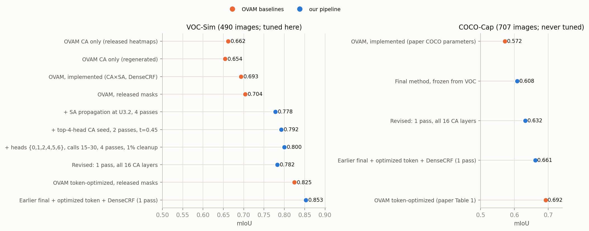

*Fig. 1. Each step of the method and the baselines. VOC-Sim values are in-sample; COCO-Cap was never used to choose the earlier final method.*

| Dataset | Method | mIoU | Evidence |
|---|---|---:|---|
| VOC-Sim | OVAM CA only (released heatmaps) | 0.6616 | B16 |
| VOC-Sim | OVAM CA only (regenerated) | 0.6540 | B8 |
| VOC-Sim | OVAM, implemented (CA×SA, DenseCRF) | 0.6934 | attention_analysis.md |
| VOC-Sim | OVAM, released masks | 0.7036 | B16 |
| VOC-Sim | + SA propagation at U3.2, 4 passes | 0.7777 | B8 |
| VOC-Sim | + top-4-head CA seed, 2 passes, t=0.45 | 0.7922 | B9 |
| VOC-Sim | + heads {0,1,2,4,5,6}, calls 15–30, 4 passes, 1% cleanup | 0.7997 | B10 |
| VOC-Sim | Revised: 1 pass, all 16 CA layers | 0.7824 | B13 |
| VOC-Sim | OVAM token-optimized, released masks | 0.8247 | B16 |
| VOC-Sim | Earlier final + optimized token + DenseCRF (1 pass) | 0.8525 | B17 |
| COCO-Cap | OVAM, implemented (paper COCO parameters) | 0.5717 | B17 |
| COCO-Cap | Final method, frozen from VOC | 0.6080 | B12 |
| COCO-Cap | Revised: 1 pass, all 16 CA layers | 0.6322 | B13 |
| COCO-Cap | Earlier final + optimized token + DenseCRF (1 pass) | 0.6612 | B17 |
| COCO-Cap | OVAM token-optimized (paper Table 1) | 0.6920 | OVAM paper |

## 4. Controlled CA experiments (tier A1, cross-validated)

Fixed condition (protocol Section 3): CA only; calls 0–30; conditional query; softmax over 77 padded tokens; mean over all class-word pieces; every module-call weighted equally; min–max at 64×64; bilinear resize; foreground at ≥ 0.45. One axis varies at a time.

### 4.1 Selection result (all five controlled CA screens)

| Screen | Package | Reference | Vote winner (votes) | OOF mIoU reference | OOF mIoU choice | OOF gain | Paired Δ image IoU [95% CI] | Δ mIoU @0.35 / 0.45 / 0.55 | Outcome |
|---|---|---|---|---:|---:|---:|---|---|---|
| CA-T | A (Codex) | time/all_00_30 | time/all_00_30 (5/5) | 0.6661 | 0.6661 | 0.0000 | +0.0000 [+0.0000, +0.0000] | +0.0000 / +0.0000 / +0.0000 | reference won the fold vote |
| CA-R | A (Codex) | resolution/r8_r16_r32_r64 | resolution/r8_r16_r64 (5/5) | 0.6661 | 0.6957 | 0.0296 | +0.0211 [+0.0139, +0.0286] | +0.0009 / +0.0296 / +0.0442 | fold vote and OOF guard passed |
| CA-L | B (Claude) | L/all_16 | L/leave2_10_11 (5/5) | 0.6661 | 0.6923 | 0.0262 | +0.0209 [+0.0155, +0.0265] | -0.0021 / +0.0262 / +0.0501 | fold vote and OOF guard passed |
| CA-H | B (Claude) | H/0_1_2_3_4_5_6_7 | H/0_2_3_4_5_6_7 (4/5) | 0.6661 | 0.6741 | 0.0080 | +0.0089 [+0.0047, +0.0131] | -0.0002 / +0.0104 / +0.0193 | fold vote and OOF guard passed |
| CA-A | B (Claude) | A/cond_padded_all | A/cond_padded_all (5/5) | 0.6661 | 0.6661 | 0.0000 | +0.0000 [+0.0000, +0.0000] | +0.0000 / +0.0000 / +0.0000 | reference won the fold vote |
| CA-C | C (Claude) | C/reference | C/R (4/5) | 0.6653 | 0.6914 | 0.0260 | +0.0217 [+0.0145, +0.0293] | +0.0010 / +0.0303 / +0.0447 | fold vote and OOF guard passed |

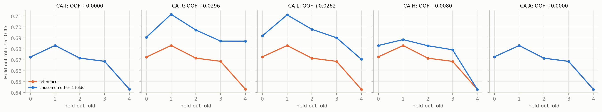

*Fig. 2. Held-out mIoU of the setting chosen on the other four folds, against the reference, per fold and screen.*

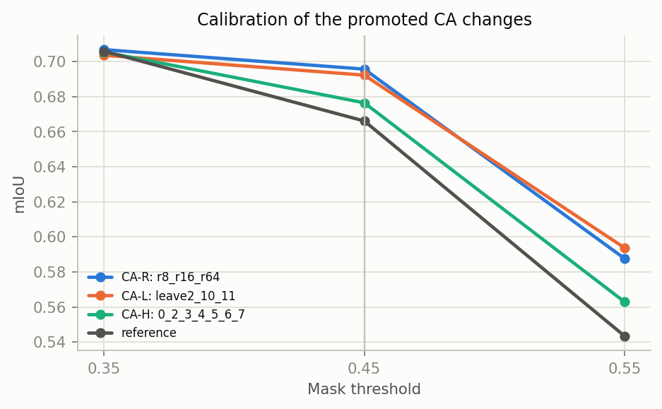

*Fig. 3. Calibration of the promoted changes. CA-R helps at every threshold but mostly at 0.45 and above; CA-L and CA-H do not help at 0.35. All three slightly lower AP, so they make the map more selective rather than ranking pixels better.*

The two packages ran in different environments on the same node. Their identical reference configuration differs by a mean of 0.0005 image IoU (max 0.018; mIoU 0.66610 vs 0.66606), so values are compared within a package; CA-C re-scores every combination in one run.

### 4.2 Combined confirmation and the frozen CA (CA-C)

The promoted single-axis changes (CA-R, CA-L, CA-H) and their combinations were scored together in one run over all 490 images (Tesla V100-PCIE-16GB, Tesla V100S-PCIE-32GB; torch 2.4.1+cu121), so every row is directly comparable. Fold vote: R 4/5, L 1/5. Out-of-fold mIoU 0.6653 → 0.6914 (gain +0.0260); paired Δ image IoU +0.0217 [+0.0145, +0.0293]. **Frozen: CA-R alone** (calls 0–30; the 11 modules at 8, 16 and 64; all 8 heads). Adding CA-H on top changes mIoU by +0.0004, inside the 0.002 tie band, so the more inclusive setting (all heads) is kept. The frozen change helps at all three thresholds (it is not calibration-dependent) but lowers mean AP from 0.9218 to 0.9131.

| Configuration | mIoU@0.45 | Δ vs reference | mIoU@0.35 | mIoU@0.55 | Mean AP | Fold votes |
|---|---:|---:|---:|---:|---:|---|
| reference (16 modules, 8 heads) | 0.6653 | 0.0000 | 0.7057 | 0.5430 | 0.9218 | 0/5 |
| CA-R: without 32×32 (11 modules) | 0.6956 | 0.0303 | 0.7067 | 0.5877 | 0.9131 | 4/5 |
| CA-L: without modules 10, 11 | 0.6921 | 0.0267 | 0.7035 | 0.5938 | 0.9201 | 1/5 |
| CA-H: without head 1 | 0.6761 | 0.0108 | 0.7056 | 0.5623 | 0.9205 | 0/5 |
| CA-R + CA-H | 0.6960 | 0.0307 | 0.7058 | 0.5879 | 0.9127 | 0/5 |
| CA-L + CA-H | 0.6924 | 0.0270 | 0.7020 | 0.5948 | 0.9190 | 0/5 |

| Combined candidate | mIoU@0.45 | Δ vs combined | Reading |
|---|---:|---:|---|
| combined CA-R + CA-H | 0.6960 | 0.0000 | — |
| without CA-R (= CA-L + CA-H) | 0.6924 | -0.0036 | CA-R contributes |
| without CA-H (= CA-R alone) | 0.6956 | -0.0004 | within the 0.002 tie: CA-H is not kept |
| without CA-L | 0.6960 | 0.0000 | CA-L is contained in CA-R |

| Held-out fold | Chosen on the other four | Train mIoU chosen | Train mIoU reference | Held-out mIoU chosen | Held-out mIoU reference |
|---|---|---:|---:|---:|---:|
| 0 | CA-R: without 32×32 (11 modules) | 0.6967 | 0.6644 | 0.6905 | 0.6708 |
| 1 | CA-R: without 32×32 (11 modules) | 0.6912 | 0.6610 | 0.7116 | 0.6827 |
| 2 | CA-R: without 32×32 (11 modules) | 0.6957 | 0.6641 | 0.6973 | 0.6714 |
| 3 | CA-R: without 32×32 (11 modules) | 0.6975 | 0.6661 | 0.6868 | 0.6676 |
| 4 | CA-L: without modules 10, 11 | 0.6977 | 0.6715 | 0.6702 | 0.6429 |

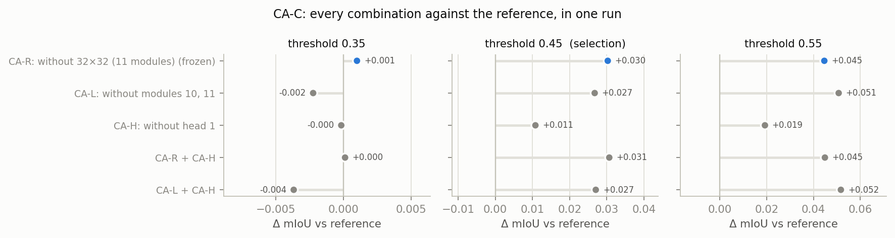

*Fig. 3b. CA-C: change in mIoU of every combination against the reference at thresholds 0.35, 0.45 and 0.55 (blue = frozen).*

### 4.3 CA denoising calls (CA-T, 79 configurations; package A, Codex)

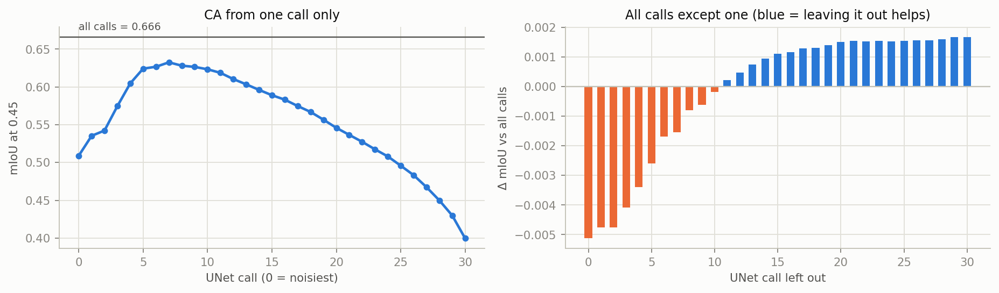

*Fig. 4a. CA from a single UNet call, and all calls except one.*

| Configuration | mIoU@0.45 | Δ vs reference | mIoU@0.35 | mIoU@0.55 | Mean AP | SD across folds |
|---|---:|---:|---:|---:|---:|---:|
| all 00 30 | 0.6661 | 0.0000 | 0.7059 | 0.5434 | 0.9218 | 0.0133 |
| window 00 04 | 0.5622 | -0.1039 | 0.5373 | 0.5393 | 0.8041 | 0.0168 |
| window 05 09 | 0.6469 | -0.0192 | 0.6742 | 0.5465 | 0.8976 | 0.0131 |
| window 10 14 | 0.6224 | -0.0437 | 0.6943 | 0.4670 | 0.9086 | 0.0122 |
| window 15 20 | 0.5796 | -0.0865 | 0.6887 | 0.4031 | 0.9048 | 0.0096 |
| window 21 25 | 0.5224 | -0.1437 | 0.6623 | 0.3409 | 0.8979 | 0.0122 |
| window 26 30 | 0.4524 | -0.2137 | 0.6159 | 0.2789 | 0.8955 | 0.0081 |
| trailing 05 30 | 0.6320 | -0.0341 | 0.7077 | 0.4803 | 0.9206 | 0.0106 |
| trailing 10 30 | 0.5893 | -0.0768 | 0.6941 | 0.4209 | 0.9132 | 0.0097 |
| trailing 15 30 | 0.5491 | -0.1170 | 0.6767 | 0.3730 | 0.9064 | 0.0114 |
| trailing 21 30 | 0.4998 | -0.1663 | 0.6509 | 0.3215 | 0.8997 | 0.0108 |
| trailing 26 30 | 0.4524 | -0.2137 | 0.6159 | 0.2789 | 0.8955 | 0.0081 |
| cumulative 00 04 | 0.5622 | -0.1039 | 0.5373 | 0.5393 | 0.8041 | 0.0168 |
| cumulative 00 09 | 0.6387 | -0.0274 | 0.6137 | 0.5860 | 0.8755 | 0.0153 |
| cumulative 00 14 | 0.6668 | 0.0007 | 0.6617 | 0.5899 | 0.9034 | 0.0134 |
| cumulative 00 20 | 0.6752 | 0.0091 | 0.6886 | 0.5763 | 0.9157 | 0.0136 |
| cumulative 00 25 | 0.6727 | 0.0066 | 0.7001 | 0.5601 | 0.9198 | 0.0138 |

### 4.4 CA resolutions (CA-R, 15 configurations; package A, Codex)

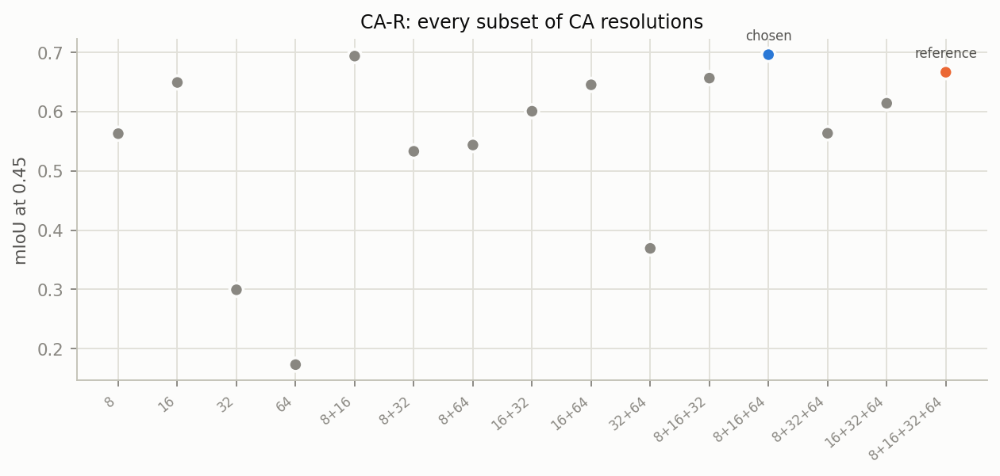

*Fig. 4b. Every subset of CA resolutions.*

| Configuration | mIoU@0.45 | Δ vs reference | mIoU@0.35 | mIoU@0.55 | Mean AP | SD across folds |
|---|---:|---:|---:|---:|---:|---:|
| 8+16+64 | 0.6957 | 0.0296 | 0.7068 | 0.5876 | 0.9131 | 0.0092 |
| 8+16 | 0.6933 | 0.0272 | 0.7148 | 0.5942 | 0.9171 | 0.0094 |
| 8+16+32+64 | 0.6661 | 0.0000 | 0.7059 | 0.5434 | 0.9218 | 0.0133 |
| 8+16+32 | 0.6562 | -0.0099 | 0.7082 | 0.5323 | 0.9240 | 0.0112 |
| 16 | 0.6489 | -0.0172 | 0.7099 | 0.5086 | 0.9059 | 0.0142 |
| 16+64 | 0.6449 | -0.0212 | 0.6906 | 0.4925 | 0.8902 | 0.0130 |
| 16+32+64 | 0.6138 | -0.0523 | 0.6849 | 0.4590 | 0.9031 | 0.0125 |
| 16+32 | 0.6004 | -0.0657 | 0.6877 | 0.4461 | 0.9092 | 0.0127 |
| 8+32+64 | 0.5632 | -0.1029 | 0.6403 | 0.4193 | 0.8929 | 0.0093 |
| 8 | 0.5626 | -0.1035 | 0.6021 | 0.4787 | 0.8462 | 0.0084 |
| 8+64 | 0.5435 | -0.1226 | 0.6001 | 0.4002 | 0.8307 | 0.0037 |
| 8+32 | 0.5328 | -0.1333 | 0.6212 | 0.4106 | 0.8969 | 0.0089 |
| 32+64 | 0.3693 | -0.2968 | 0.5075 | 0.2045 | 0.8043 | 0.0109 |
| 32 | 0.2995 | -0.3666 | 0.4422 | 0.1740 | 0.8221 | 0.0115 |
| 64 | 0.1734 | -0.4927 | 0.3285 | 0.0631 | 0.5604 | 0.0084 |

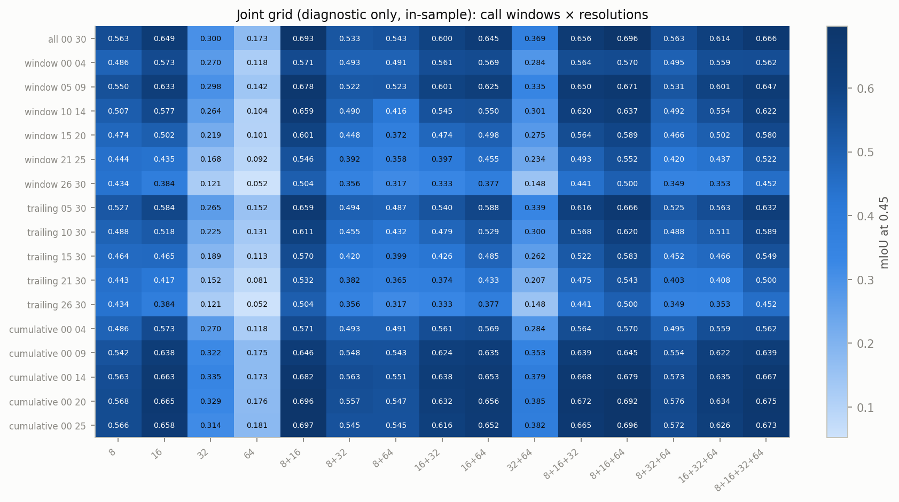

*Fig. 4c. Joint grid of call windows and resolutions (diagnostic only; cannot freeze a setting).*

### 4.5 CA layers (CA-L, 159 configurations)

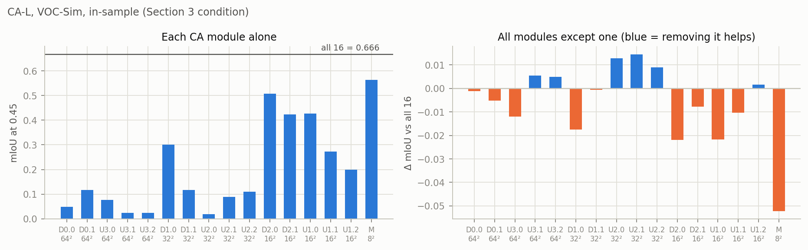

*Fig. 4. Each CA module alone (left) and all modules except one (right).*

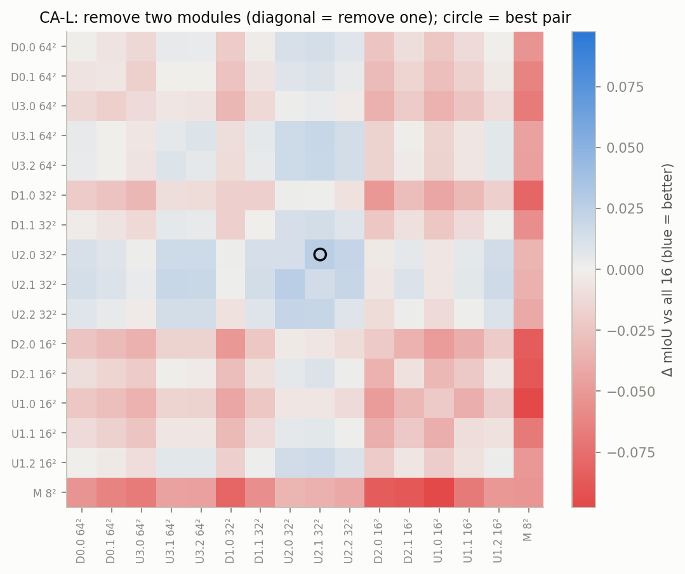

*Fig. 5. All 120 leave-two-out configurations; the diagonal is leave-one-out.*

| Configuration | mIoU@0.45 | Δ vs all 16 | mIoU@0.35 | mIoU@0.55 | Mean AP | SD across folds |
|---|---:|---:|---:|---:|---:|---:|
| without 10 U2.0 & 11 U2.1 | 0.6923 | 0.0262 | 0.7036 | 0.5937 | 0.9201 | 0.0132 |
| without 10 U2.0 & 12 U2.2 | 0.6870 | 0.0209 | 0.7060 | 0.5832 | 0.9199 | 0.0124 |
| without 11 U2.1 & 12 U2.2 | 0.6860 | 0.0200 | 0.7016 | 0.5825 | 0.9179 | 0.0147 |
| without 11 U2.1 & 14 U3.1 | 0.6852 | 0.0191 | 0.7076 | 0.5771 | 0.9220 | 0.0156 |
| without 11 U2.1 & 15 U3.2 | 0.6851 | 0.0190 | 0.7062 | 0.5756 | 0.9207 | 0.0154 |
| without 10 U2.0 & 14 U3.1 | 0.6831 | 0.0170 | 0.7088 | 0.5743 | 0.9236 | 0.0131 |
| without 10 U2.0 & 15 U3.2 | 0.6828 | 0.0168 | 0.7070 | 0.5731 | 0.9222 | 0.0134 |
| without 09 U1.2 & 11 U2.1 | 0.6826 | 0.0165 | 0.7026 | 0.5725 | 0.9183 | 0.0151 |
| without 09 U1.2 & 10 U2.0 | 0.6806 | 0.0145 | 0.7037 | 0.5697 | 0.9200 | 0.0131 |
| without 03 D1.1 & 11 U2.1 | 0.6803 | 0.0142 | 0.7078 | 0.5678 | 0.9213 | 0.0148 |

The single-module and leave-one-out values for all 16 modules are in `tables/a1_ca_l.md`.

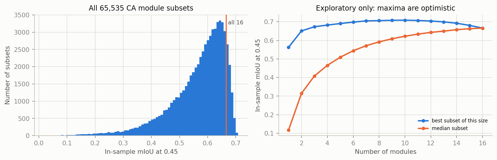

*Fig. 6. All 65,535 module subsets (exploratory; the maximum is not eligible for selection).*

### 4.6 CA heads (CA-H, 255 subsets)

| Head | Alone | All but this head | Δ vs all 8 | Folds retaining it |
|---|---:|---:|---:|---|
| 0 | 0.2557 | 0.6484 | -0.0177 | 5/5 |
| 1 | 0.0975 | 0.6765 | 0.0104 | 1/5 |
| 2 | 0.3638 | 0.6471 | -0.0190 | 5/5 |
| 3 | 0.3556 | 0.6549 | -0.0112 | 5/5 |
| 4 | 0.4344 | 0.6448 | -0.0213 | 5/5 |
| 5 | 0.4179 | 0.6516 | -0.0144 | 5/5 |
| 6 | 0.3208 | 0.6456 | -0.0205 | 5/5 |
| 7 | 0.3165 | 0.6581 | -0.0080 | 5/5 |

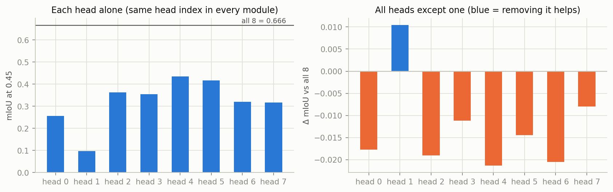

*Fig. 7. Each head alone and all heads except one (the same head index in every module).*

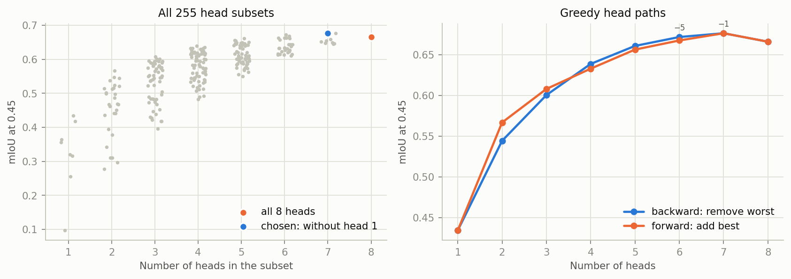

*Fig. 8. All 255 head subsets by size, and the greedy removal and addition paths.*

| Round | Removed | Heads left | mIoU@0.45 |
|---|---|---|---:|
| 0 | — | 0 1 2 3 4 5 6 7 | 0.6661 |
| 1 | 1 | 0 2 3 4 5 6 7 | 0.6765 |
| 2 | 5 | 0 2 3 4 6 7 | 0.6718 |
| 3 | 7 | 0 2 3 4 6 | 0.6609 |
| 4 | 0 | 2 3 4 6 | 0.6388 |
| 5 | 2 | 3 4 6 | 0.6005 |
| 6 | 6 | 3 4 | 0.5444 |
| 7 | 3 | 4 | 0.4344 |

| Head subset | Heads | mIoU@0.45 | Δ vs all 8 | mIoU@0.35 | mIoU@0.55 | Mean AP |
|---|---:|---:|---:|---:|---:|---:|
| 0 2 3 4 5 6 7 | 7 | 0.6765 | 0.0104 | 0.7055 | 0.5629 | 0.9206 |
| 0 2 3 4 6 7 | 6 | 0.6718 | 0.0058 | 0.7110 | 0.5406 | 0.9121 |
| 0 2 3 4 5 6 | 6 | 0.6676 | 0.0015 | 0.7044 | 0.5514 | 0.9138 |
| 0 1 2 3 4 5 6 7 | 8 | 0.6661 | -0.0000 | 0.7057 | 0.5435 | 0.9218 |
| 0 2 3 4 5 7 | 6 | 0.6629 | -0.0031 | 0.7038 | 0.5377 | 0.9173 |
| 0 3 4 5 6 7 | 6 | 0.6626 | -0.0035 | 0.6928 | 0.5373 | 0.9084 |
| 2 3 4 5 6 7 | 6 | 0.6625 | -0.0035 | 0.7035 | 0.5405 | 0.9236 |
| 0 2 4 5 6 7 | 6 | 0.6615 | -0.0046 | 0.7011 | 0.5424 | 0.9140 |
| 0 2 3 4 6 | 5 | 0.6609 | -0.0052 | 0.7095 | 0.5248 | 0.9005 |
| 0 1 2 3 4 5 6 | 7 | 0.6581 | -0.0080 | 0.7044 | 0.5371 | 0.9167 |
| 0 2 3 5 6 7 | 6 | 0.6571 | -0.0090 | 0.6935 | 0.5325 | 0.9092 |
| 2 3 4 5 6 | 5 | 0.6564 | -0.0097 | 0.7032 | 0.5324 | 0.9173 |
| 0 1 2 4 5 6 7 | 7 | 0.6549 | -0.0112 | 0.7021 | 0.5274 | 0.9155 |
| 0 2 3 4 5 | 5 | 0.6541 | -0.0120 | 0.7022 | 0.5275 | 0.9137 |
| 0 1 2 3 4 6 7 | 7 | 0.6516 | -0.0144 | 0.7059 | 0.5060 | 0.9142 |

### 4.7 CA attribution convention (CA-A, 12 configurations)

| Query branch | Softmax | Class pieces | mIoU@0.45 | Δ vs reference | mIoU@0.35 | mIoU@0.55 | Mean AP |
|---|---|---|---:|---:|---:|---:|---:|
| conditional | unpadded | all | 0.6678 | 0.0018 | 0.7054 | 0.5480 | 0.9245 |
| conditional | padded | all | 0.6661 | 0.0000 | 0.7057 | 0.5435 | 0.9218 |
| unconditional | padded | all | 0.6612 | -0.0048 | 0.6992 | 0.5489 | 0.9222 |
| unconditional | unpadded | all | 0.6610 | -0.0050 | 0.6986 | 0.5506 | 0.9241 |
| conditional | unpadded | last | 0.6597 | -0.0063 | 0.6998 | 0.5414 | 0.9246 |
| conditional | padded | last | 0.6579 | -0.0082 | 0.7000 | 0.5365 | 0.9219 |
| unconditional | padded | last | 0.6541 | -0.0119 | 0.6938 | 0.5436 | 0.9223 |
| unconditional | unpadded | last | 0.6539 | -0.0122 | 0.6935 | 0.5454 | 0.9243 |
| unconditional | unpadded | first | 0.6505 | -0.0156 | 0.6970 | 0.5252 | 0.9127 |
| conditional | unpadded | first | 0.6479 | -0.0182 | 0.6962 | 0.5172 | 0.9107 |
| unconditional | padded | first | 0.6474 | -0.0187 | 0.6967 | 0.5199 | 0.9106 |
| conditional | padded | first | 0.6451 | -0.0210 | 0.6953 | 0.5112 | 0.9080 |

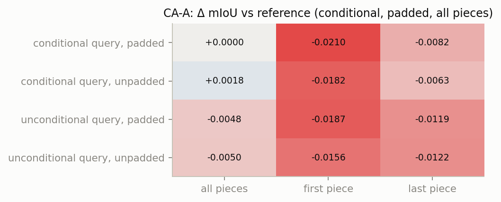

*Fig. 9. Δ mIoU of every convention against the reference. The earlier final method used OVAM's cell (unconditional, unpadded, first piece).*

### 4.8 What the cross-attention maps look like

Head-averaged CA of every module, calls 0–30, upsampled to 64×64 on a common colour scale, one row per resolution. The four images were fixed by index before any result was seen.

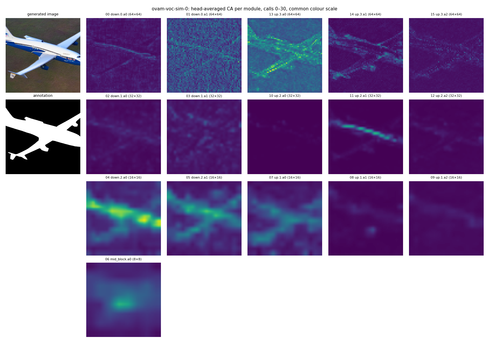

*Fig. CA maps, ovam-voc-sim-0.*

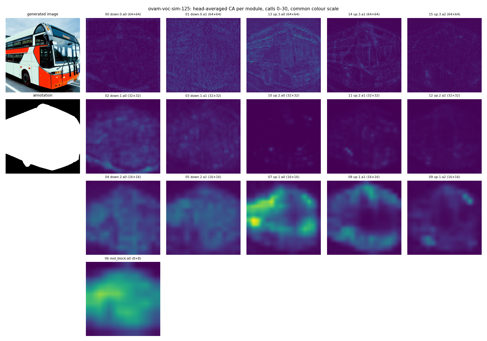

*Fig. CA maps, ovam-voc-sim-125.*

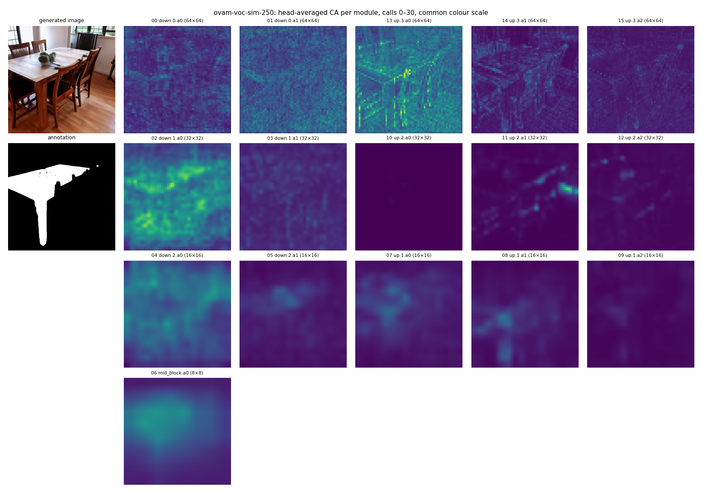

*Fig. CA maps, ovam-voc-sim-250.*

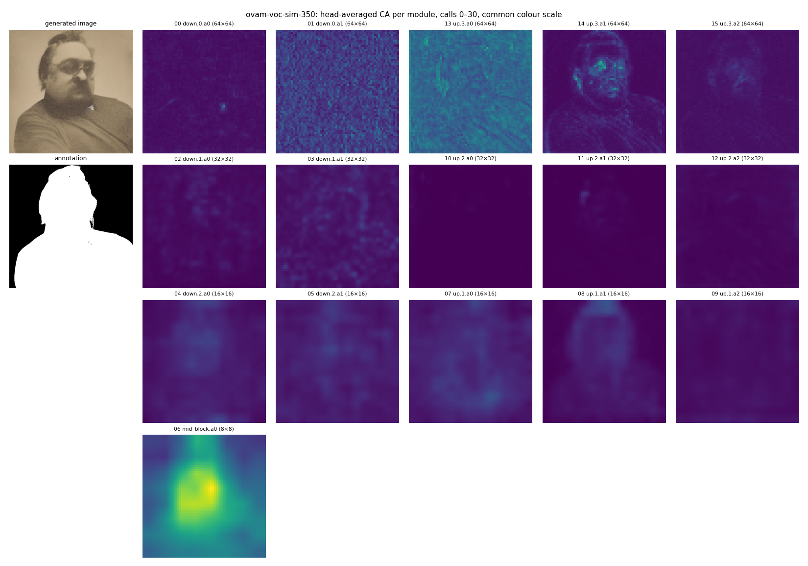

*Fig. CA maps, ovam-voc-sim-350.*

## 5. Controlled SA experiments (tier A4, cross-validated)

Fixed condition (protocol Section 6): the frozen CA map is the seed, area-downsampled to each SA module's grid; one pass y = A x with the conditional SA affinity of every module, head and call (equal weights); bilinear to 64×64; min–max; foreground at ≥ 0.45. SA package A (SA-T calls, SA-R resolutions; A5) was run by Codex, SA package B (SA-L modules, SA-H heads; A4) by Claude, and the combined confirmation SA-C (A6) by Codex.

### 5.1 Combined confirmation and the frozen SA (SA-C, run by Codex)

T = call 30 only (SA-T), R = resolutions 8+64 (SA-R), L = module 15 only (SA-L), H = heads 1, 4, 6 (SA-H). Every unique combination was scored in one run (R adds nothing once L is active, since module 15 is 64×64). Fold vote: L 5/5. Out-of-fold mIoU 0.7556 → 0.7887 (gain +0.0330); paired Δ image IoU +0.0417 [+0.0365, +0.0468], 403 images better and 87 worse. **Frozen: module 15 only, all calls, all heads.** It helps at all three thresholds and raises mean AP (0.9536 → 0.9560). Restricting calls (T), resolutions (R) or heads (H) helped on its own but does not survive the combination with L. 18/20 classes improve; the largest losses are `person` -0.055, `tv` -0.018.

| Configuration | mIoU@0.45 | Δ vs reference | mIoU@0.35 | mIoU@0.55 | Mean AP | Fold votes |
|---|---:|---:|---:|---:|---:|---|
| reference (16 SA modules, 31 calls, 8 heads) | 0.7556 | 0.0000 | 0.7213 | 0.7466 | 0.9536 | 0/5 |
| T: call 30 only | 0.7710 | 0.0153 | 0.7465 | 0.7457 | 0.9551 | 0/5 |
| R: resolutions 8+64 | 0.7676 | 0.0119 | 0.7414 | 0.7399 | 0.9542 | 0/5 |
| L: module 15 only (U3.2) | 0.7887 | 0.0330 | 0.7691 | 0.7532 | 0.9560 | 5/5 |
| H: heads 1, 4, 6 | 0.7613 | 0.0057 | 0.7295 | 0.7470 | 0.9552 | 0/5 |
| T + R | 0.7749 | 0.0193 | 0.7659 | 0.7244 | 0.9517 | 0/5 |
| T + L | 0.7820 | 0.0264 | 0.7704 | 0.7260 | 0.9474 | 0/5 |
| T + H | 0.7732 | 0.0175 | 0.7534 | 0.7412 | 0.9563 | 0/5 |
| R + H | 0.7656 | 0.0099 | 0.7389 | 0.7343 | 0.9534 | 0/5 |
| L + H | 0.7871 | 0.0314 | 0.7637 | 0.7554 | 0.9587 | 0/5 |
| T + R + H | 0.7692 | 0.0136 | 0.7669 | 0.7098 | 0.9512 | 0/5 |
| T + L + H | 0.7825 | 0.0268 | 0.7658 | 0.7330 | 0.9514 | 0/5 |

| Component | With | Without | Δ mIoU@0.45 |
|---|---|---|---:|
| T within T+L+H | T + L + H | L + H | -0.0046 |
| L within T+L+H | T + L + H | T + H | 0.0093 |
| H within T+L+H | T + L + H | T + L | 0.0005 |
| R within T+R+H | T + R + H | T + H | -0.0040 |

| Held-out fold | Chosen on the other four | Train mIoU chosen | Train mIoU reference | Held-out mIoU chosen | Held-out mIoU reference |
|---|---|---:|---:|---:|---:|
| 0 | L: module 15 only (U3.2) | 0.7892 | 0.7580 | 0.7892 | 0.7465 |
| 1 | L: module 15 only (U3.2) | 0.7825 | 0.7490 | 0.8116 | 0.7780 |
| 2 | L: module 15 only (U3.2) | 0.7899 | 0.7571 | 0.7869 | 0.7518 |
| 3 | L: module 15 only (U3.2) | 0.7908 | 0.7578 | 0.7825 | 0.7460 |
| 4 | L: module 15 only (U3.2) | 0.7910 | 0.7559 | 0.7757 | 0.7484 |

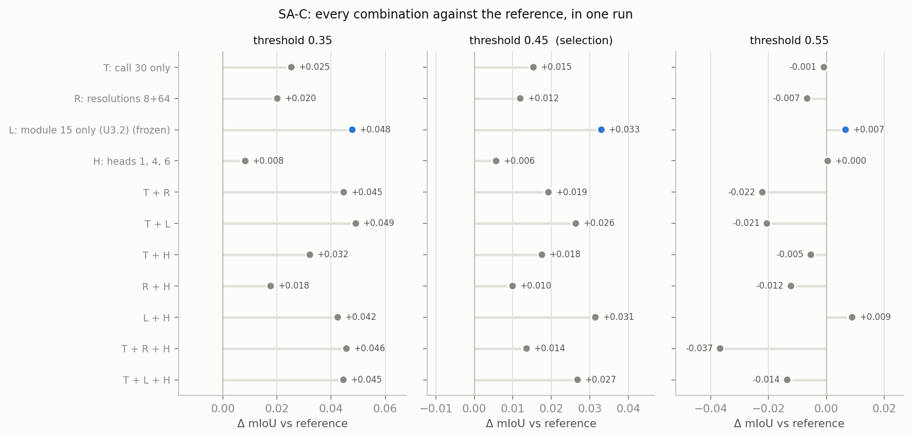

*Fig. 13a. SA-C: change in mIoU of every combination against the SA reference at thresholds 0.35, 0.45 and 0.55 (blue = frozen).*

| Class | Reference | Module 15 only | Δ |
|---|---:|---:|---:|
| chair | 0.5289 | 0.6503 | 0.1214 |
| aeroplane | 0.7309 | 0.8450 | 0.1141 |
| bicycle | 0.6788 | 0.7471 | 0.0683 |
| boat | 0.7638 | 0.8318 | 0.0680 |
| bird | 0.7859 | 0.8531 | 0.0673 |
| bottle | 0.8126 | 0.8665 | 0.0539 |
| horse | 0.8300 | 0.8696 | 0.0396 |
| motorbike | 0.8157 | 0.8527 | 0.0370 |
| dog | 0.8692 | 0.8960 | 0.0268 |
| car | 0.8152 | 0.8420 | 0.0268 |
| train | 0.6470 | 0.6697 | 0.0227 |
| sofa | 0.9230 | 0.9447 | 0.0217 |
| dining-table | 0.4511 | 0.4677 | 0.0166 |
| cow | 0.8055 | 0.8184 | 0.0129 |
| cat | 0.7688 | 0.7816 | 0.0127 |
| bus | 0.9064 | 0.9184 | 0.0120 |
| sheep | 0.7564 | 0.7660 | 0.0096 |
| potted-plant | 0.7064 | 0.7091 | 0.0027 |
| tv | 0.7953 | 0.7768 | -0.0184 |
| person | 0.7218 | 0.6664 | -0.0554 |

### 5.2 SA denoising calls and resolutions (SA-T, SA-R; package A, Codex)

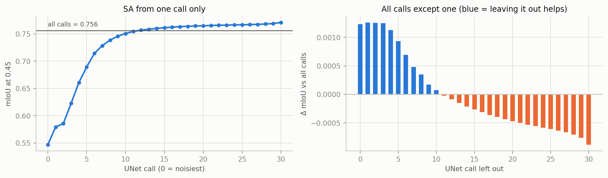

*Fig. 13b. SA from a single UNet call, and all calls except one.*

| Configuration | mIoU@0.45 | Δ vs reference | mIoU@0.35 | mIoU@0.55 | Mean AP | SD across folds |
|---|---:|---:|---:|---:|---:|---:|
| all 00 30 | 0.7556 | 0.0000 | 0.7213 | 0.7466 | 0.9536 | 0.0121 |
| window 00 04 | 0.6105 | -0.1452 | 0.5513 | 0.6432 | 0.8907 | 0.0175 |
| window 05 09 | 0.7290 | -0.0266 | 0.6893 | 0.7286 | 0.9424 | 0.0130 |
| window 10 14 | 0.7569 | 0.0012 | 0.7241 | 0.7470 | 0.9535 | 0.0118 |
| window 15 20 | 0.7636 | 0.0079 | 0.7354 | 0.7477 | 0.9548 | 0.0110 |
| window 21 25 | 0.7661 | 0.0105 | 0.7412 | 0.7453 | 0.9544 | 0.0100 |
| window 26 30 | 0.7687 | 0.0131 | 0.7447 | 0.7447 | 0.9545 | 0.0098 |
| trailing 05 30 | 0.7617 | 0.0060 | 0.7318 | 0.7473 | 0.9549 | 0.0114 |
| trailing 10 30 | 0.7650 | 0.0093 | 0.7376 | 0.7474 | 0.9552 | 0.0108 |
| trailing 15 30 | 0.7663 | 0.0107 | 0.7407 | 0.7465 | 0.9549 | 0.0103 |
| trailing 21 30 | 0.7675 | 0.0119 | 0.7432 | 0.7452 | 0.9545 | 0.0098 |
| trailing 26 30 | 0.7687 | 0.0131 | 0.7447 | 0.7447 | 0.9545 | 0.0098 |
| cumulative 00 04 | 0.6105 | -0.1452 | 0.5513 | 0.6432 | 0.8907 | 0.0175 |
| cumulative 00 09 | 0.6956 | -0.0600 | 0.6390 | 0.7114 | 0.9318 | 0.0151 |
| cumulative 00 14 | 0.7276 | -0.0280 | 0.6813 | 0.7337 | 0.9454 | 0.0136 |
| cumulative 00 20 | 0.7441 | -0.0116 | 0.7042 | 0.7429 | 0.9508 | 0.0132 |
| cumulative 00 25 | 0.7510 | -0.0046 | 0.7143 | 0.7454 | 0.9526 | 0.0126 |

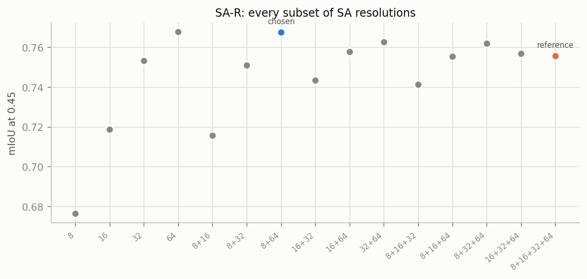

*Fig. 13c. Every subset of SA resolutions.*

| Configuration | mIoU@0.45 | Δ vs reference | mIoU@0.35 | mIoU@0.55 | Mean AP | SD across folds |
|---|---:|---:|---:|---:|---:|---:|
| 64 | 0.7678 | 0.0121 | 0.7474 | 0.7309 | 0.9539 | 0.0124 |
| 8+64 | 0.7676 | 0.0119 | 0.7414 | 0.7399 | 0.9542 | 0.0128 |
| 32+64 | 0.7627 | 0.0070 | 0.7388 | 0.7369 | 0.9550 | 0.0125 |
| 8+32+64 | 0.7619 | 0.0063 | 0.7356 | 0.7399 | 0.9549 | 0.0125 |
| 16+64 | 0.7578 | 0.0021 | 0.7199 | 0.7507 | 0.9531 | 0.0120 |
| 16+32+64 | 0.7568 | 0.0012 | 0.7237 | 0.7457 | 0.9538 | 0.0120 |
| 8+16+32+64 | 0.7556 | 0.0000 | 0.7213 | 0.7466 | 0.9536 | 0.0121 |
| 8+16+64 | 0.7554 | -0.0002 | 0.7158 | 0.7516 | 0.9529 | 0.0123 |
| 32 | 0.7532 | -0.0024 | 0.7275 | 0.7353 | 0.9534 | 0.0119 |
| 8+32 | 0.7510 | -0.0047 | 0.7214 | 0.7387 | 0.9528 | 0.0122 |
| 16+32 | 0.7434 | -0.0123 | 0.7066 | 0.7426 | 0.9503 | 0.0113 |
| 8+16+32 | 0.7413 | -0.0144 | 0.7033 | 0.7430 | 0.9499 | 0.0116 |
| 16 | 0.7187 | -0.0370 | 0.6749 | 0.7352 | 0.9402 | 0.0108 |
| 8+16 | 0.7156 | -0.0400 | 0.6706 | 0.7343 | 0.9399 | 0.0112 |
| 8 | 0.6764 | -0.0793 | 0.6237 | 0.6992 | 0.9030 | 0.0137 |

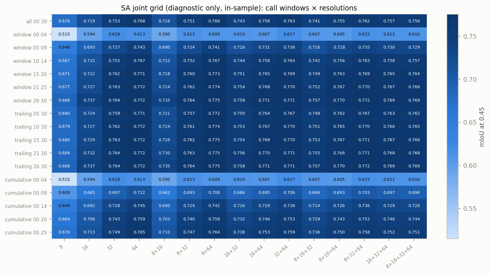

*Fig. 13d. SA joint grid of call windows and resolutions (diagnostic only).*

### 5.3 SA modules and heads (SA-L, SA-H; package B)

| Screen | Reference | Vote winner (votes) | OOF mIoU reference | OOF mIoU choice | OOF gain | Paired Δ image IoU [95% CI] | Δ mIoU @0.35 / 0.45 / 0.55 | Outcome |
|---|---|---|---:|---:|---:|---|---|---|
| SA-L | SL/all_16 | SL/single_15 (5/5) | 0.7553 | 0.7884 | 0.0331 | +0.0417 [+0.0365, +0.0469] | +0.0477 / +0.0331 / +0.0068 | fold vote and OOF guard passed |
| SA-H | SH/0_1_2_3_4_5_6_7 | SH/1_4_6 (5/5) | 0.7553 | 0.7610 | 0.0057 | +0.0065 [+0.0056, +0.0074] | +0.0083 / +0.0057 / +0.0004 | fold vote and OOF guard passed |

| Configuration | mIoU@0.45 | Δ vs SA reference | mIoU@0.35 | mIoU@0.55 | Mean AP |
|---|---:|---:|---:|---:|---:|
| frozen CA seed alone (no SA) | 0.6956 | -0.0597 | 0.7067 | 0.5877 | 0.9131 |
| SA reference: all 16 SA modules, 8 heads, y = A x | 0.7553 | 0.0000 | 0.7212 | 0.7463 | 0.9535 |
| operator check: y = Aᵀx | 0.4741 | -0.2813 | 0.5914 | 0.3273 | 0.9179 |
| SA-L choice: single_15 | 0.7884 | 0.0331 | 0.7689 | 0.7531 | 0.9559 |
| SA-H choice: heads 1, 4, 6 | 0.7610 | 0.0057 | 0.7294 | 0.7467 | 0.9552 |

**SA-L.** One SA module, single_15 (U3.2, 64×64), beats all 16 in every fold (OOF 0.7553 → 0.7884). The exploratory search over all 65,535 SA module subsets picks the same single module in 5/5 folds. This is the module the exploratory B8 screen had already chosen.

**SA-H.** Heads 1, 4, 6 in every SA module, 5/5 folds, OOF gain +0.0057 (the conditional band of Section 5: 18/20 classes improve, the largest class loss is 0.003). Head 4 alone is 0.0015 higher in-sample, inside the 0.002 tie band, so the more inclusive subset is kept.

**Operator.** The transposed operator y = Aᵀx is far worse than y = A x, which confirms the orientation used throughout.

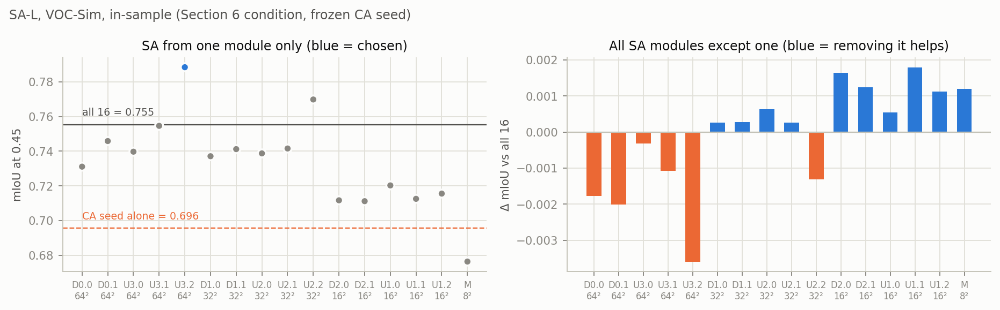

*Fig. 13. SA-L: SA from one module only, and all SA modules except one.*

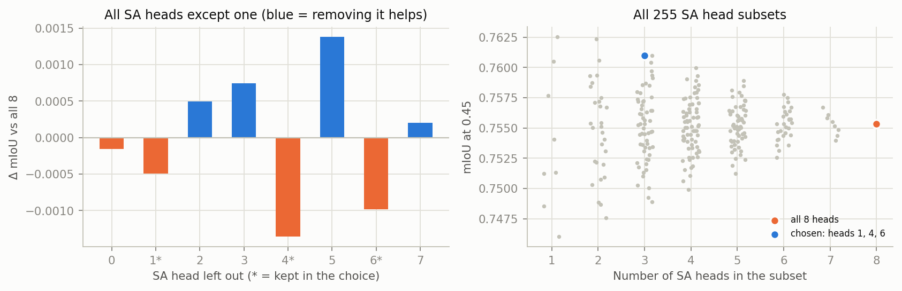

*Fig. 14. SA-H: leaving out one SA head, and all 255 SA head subsets by size.*

| Head | Alone | All but this head | Δ vs all 8 | Folds retaining it |
|---|---:|---:|---:|---|
| 0 | 0.7541 | 0.7552 | -0.0002 | 0/5 |
| 1 | 0.7577 | 0.7548 | -0.0005 | 5/5 |
| 2 | 0.7512 | 0.7558 | 0.0005 | 0/5 |
| 3 | 0.7486 | 0.7561 | 0.0007 | 0/5 |
| 4 | 0.7625 | 0.7540 | -0.0014 | 5/5 |
| 5 | 0.7460 | 0.7567 | 0.0014 | 0/5 |
| 6 | 0.7605 | 0.7544 | -0.0010 | 5/5 |
| 7 | 0.7513 | 0.7555 | 0.0002 | 0/5 |

| Head subset | Heads | mIoU@0.45 | Δ vs all 8 | mIoU@0.35 | mIoU@0.55 | Mean AP |
|---|---:|---:|---:|---:|---:|---:|
| 4 | 1 | 0.7625 | 0.0072 | 0.7301 | 0.7473 | 0.9564 |
| 4 6 | 2 | 0.7623 | 0.0070 | 0.7288 | 0.7498 | 0.9550 |
| 1 4 6 | 3 | 0.7610 | 0.0057 | 0.7294 | 0.7467 | 0.9552 |
| 1 4 | 2 | 0.7606 | 0.0053 | 0.7302 | 0.7446 | 0.9561 |
| 6 | 1 | 0.7605 | 0.0052 | 0.7255 | 0.7499 | 0.9523 |
| 0 4 6 | 3 | 0.7604 | 0.0051 | 0.7238 | 0.7522 | 0.9544 |
| 0 1 4 6 | 4 | 0.7600 | 0.0047 | 0.7258 | 0.7494 | 0.9547 |
| 4 6 7 | 3 | 0.7597 | 0.0044 | 0.7278 | 0.7463 | 0.9544 |
| 0 1 4 | 3 | 0.7594 | 0.0040 | 0.7249 | 0.7490 | 0.9553 |
| 1 6 | 2 | 0.7594 | 0.0040 | 0.7281 | 0.7453 | 0.9539 |

Single-module and leave-one-out values for all 16 SA modules: `tables/a4_sa_l.md`.

## 6. Exploratory SA experiments (tier B)

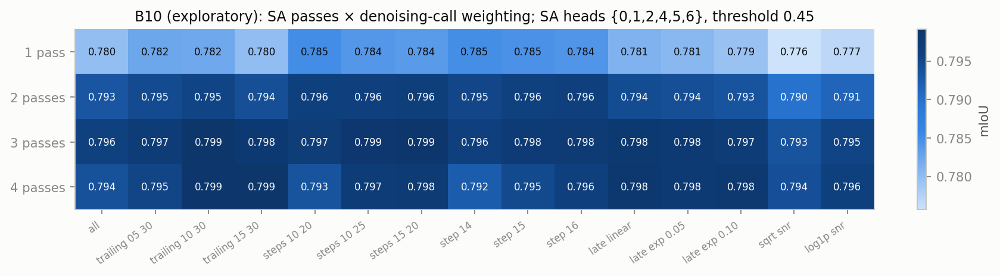

*Fig. 10. B10: SA passes × denoising-call weighting (in-sample).*

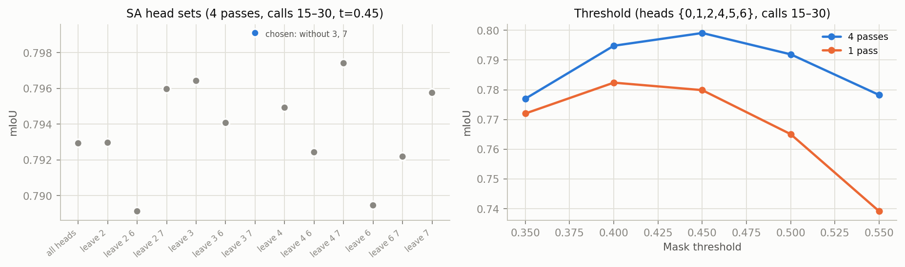

*Fig. 11. B10: SA head subsets and the mask threshold (in-sample).*

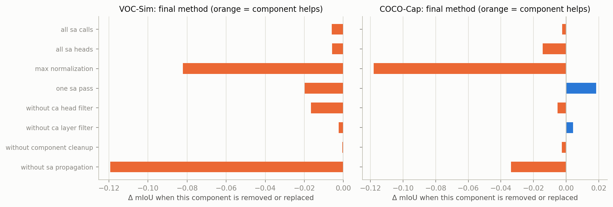

*Fig. 12. Removing one component of the earlier final method, on VOC-Sim and on the untuned COCO-Cap.*

Best configuration of every family in the large VOC-Sim experiments: `tables/b_family_winners.md`. Component ablations of the final and revised systems: `tables/b_component_ablations.md`.

## 7. Optimized token and DenseCRF (exploratory, nothing selected)

| Dataset | Configuration | mIoU |
|---|---|---:|
| VOC-Sim | ovam_implemented | 0.6945 |
| VOC-Sim | plain_top4/sa_iter1 | 0.7802 |
| VOC-Sim | plain_top4/sa_iter1+crf | 0.7957 |
| VOC-Sim | opt_top4/sa_iter1 | 0.8347 |
| VOC-Sim | opt_top4/sa_iter1+crf | 0.8525 |
| VOC-Sim | opt_all16/sa_iter1+crf | 0.8553 |
| VOC-Sim | plain_top4/sa_iter4 | 0.8000 |
| VOC-Sim | opt_top4/sa_iter4+crf | 0.8521 |
| COCO-Cap | ovam_implemented | 0.5717 |
| COCO-Cap | plain_top4/sa_iter1 | 0.6264 |
| COCO-Cap | plain_top4/sa_iter1+crf | 0.6432 |
| COCO-Cap | opt_top4/sa_iter1 | 0.6419 |
| COCO-Cap | opt_top4/sa_iter1+crf | 0.6612 |
| COCO-Cap | opt_all16/sa_iter1+crf | 0.6552 |
| COCO-Cap | plain_top4/sa_iter4 | 0.6077 |
| COCO-Cap | opt_top4/sa_iter4+crf | 0.6369 |
| VOC-Sim | released OVAM token-optimized masks | 0.8247 |
| COCO-Cap | OVAM token-optimized (paper) | 0.6920 |

## 8. Limits of this evidence

- Tier B settings were chosen on the reported images; only COCO-Cap is untouched by the earlier final method, and the revised one-pass system was informed by COCO-Cap.
- Tier A is complete for CA and SA (screens and both combined confirmations). The deferred phase (Section 8: repeated passes, fusion, calibration, cleanup, DenseCRF, tokens) and the COCO-Cap transfer of the frozen method are still to run.
- The frozen SA (module 15 only) lowers `person` IoU by 0.055; SA-T and SA-R were calibration-dependent and do not survive SA-C.
- The frozen CA change (CA-R) helps mainly at the 0.45 selection threshold and above and slightly lowers AP; CA-L and CA-H change sign at 0.35 (Fig. 3).
- CA-C ran on V100 GPUs, packages A and B on an A100; the identical reference differs by 0.0007 mIoU across them, so CA-C rows are compared only with each other.
- Released OVAM masks were made on the authors' renders; all other rows use regenerated images scored on the same annotations.
